# Code Metrics — Visual Reference

> Metric definitions: `code-metrics`, `functional-core`, `deep-modules`, `lean-design` skills.
> Data examples sourced from the ExampleSDK Python subsystem (2026-07-09).

This is a selective explanatory catalog, not the executable metric or diff-gate contract. The
complete CREST vector contains 8 functional-core metrics plus approximately 21 deep-modules and
lean-design metrics (approximately 29 total); the authoritative ownership, counting, direction,
and gate-status rules are in the source skills named above.

---

## 1. The Metric Family Tree

Each metric illustrated here belongs to one of three rubrics. The rubric determines *how* a metric
is scored qualitatively; this reference explains selected metrics and does not replace the full
catalog or executable contract.

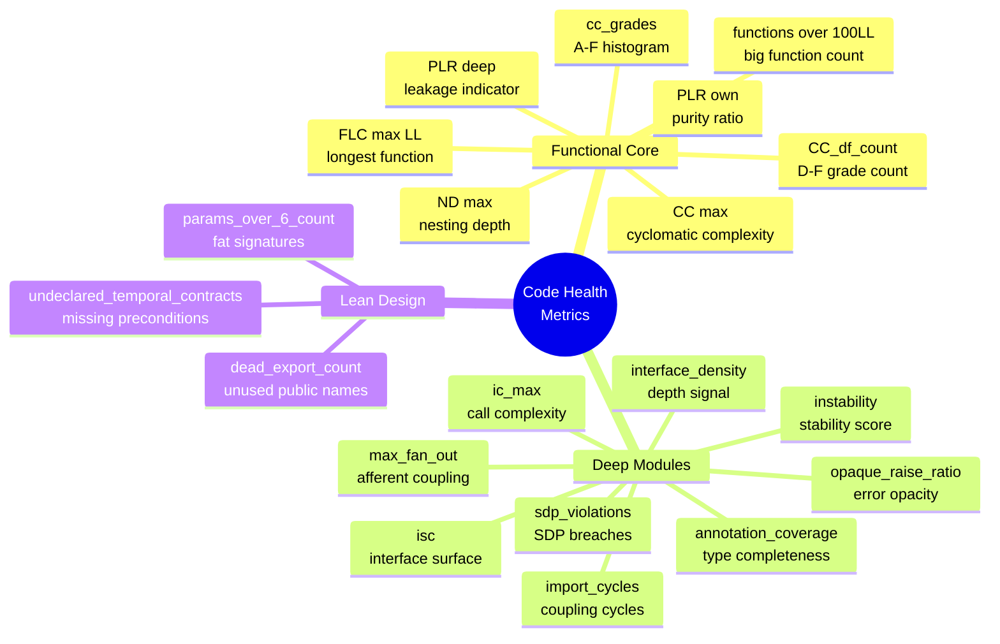

---

## 2. Functional Core — The Purity Stack

The core idea: a function is **pure** if it can be tested with plain values and no mocks.
The degree of purity in the codebase predicts how much of the logic is isolated from
side-effects, and therefore how testable and reasoning-friendly it is.

### 2.1 Effect Taxonomy — What Disqualifies Purity

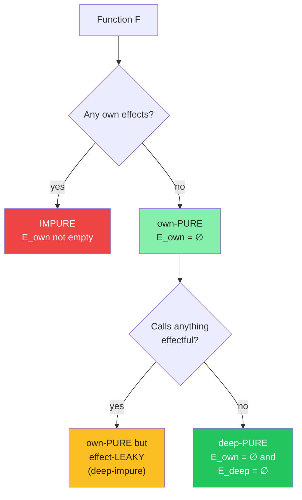

**Six disqualifying own-effects:**
| # | Effect | Example |
|---|--------|---------|
| 1 | Argument mutation visible to caller | `list.append(x)` on a passed-in list |
| 2 | Global / module state mutation | Writing to a global, singleton, or `self.state` |
| 3 | I/O | network, filesystem, DB, stdout, logging |
| 4 | Nondeterministic read | `time.time()`, `random.random()`, env vars |
| 5 | Read of mutable external state | Reading a singleton that affects the return |
| 6 | (deep only) Calling an effectful function | Effect propagates transitively |

**What is NOT an effect (purity preserved):**
- Local mutation of data allocated *inside* the function (build a list, then return it)
- Deterministic exceptions on contract violation (same input → same throw)
- Reads of an injected, immutable value passed as an argument

---

### 2.2 PLR — Purity Ratio (the headline metric)

$$PLR = \frac{PLL}{LL} = \frac{\text{logic lines in deep-pure functions}}{\text{total logic lines}}$$

**Why size-weighted instead of function-count?**

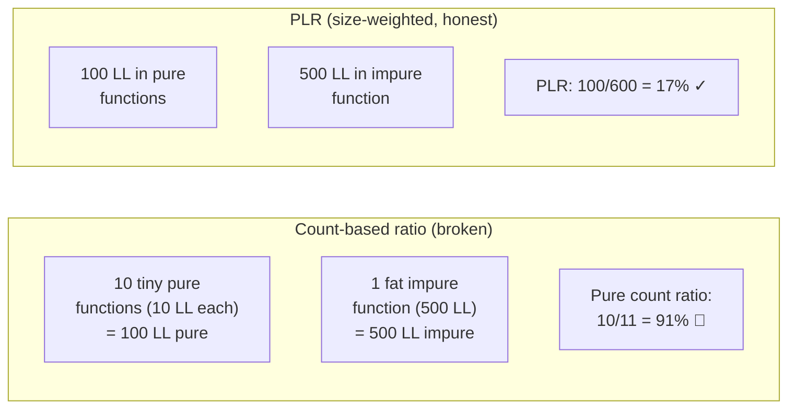

A fat impure function cannot hide behind a swarm of tiny pure helpers.
The **denominator is all logic lines** — the shell counts against PLR, incentivizing a *thin* shell.

**ExampleSDK current values:**

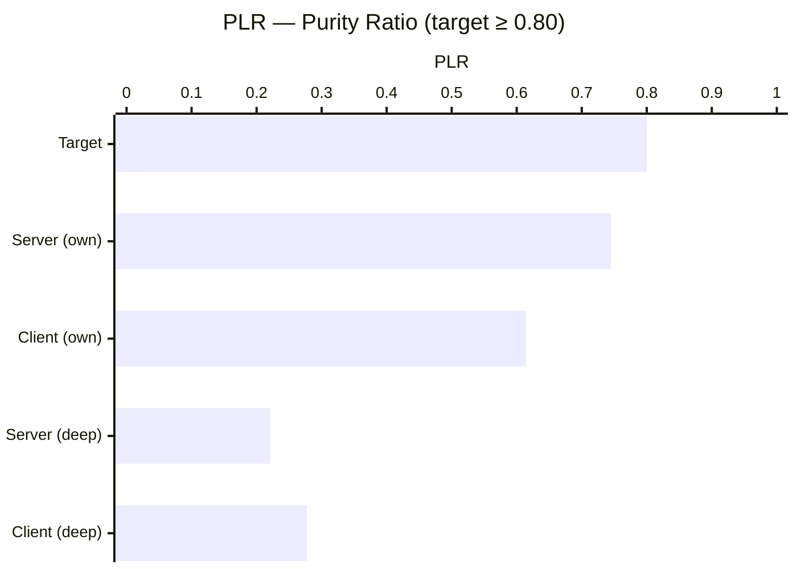

- **own-PLR** counts effects in a function's own body only (logging counts)
- **deep-PLR** propagates effects transitively — the honest figure
- The large gap between own and deep PLR (0.745 → 0.221 in server) means effects
  are leaking *downward* through the call graph into otherwise-pure logic.

---

### 2.3 CC — Cyclomatic Complexity

$$CC(f) = \text{decision points in } f + 1$$

Decision points are: `if`, `elif`, `else`, `for`, `while`, `except`, `with`, `assert`,
boolean operators (`and`, `or`) in conditions, comprehension `if` clauses.

**Grade scale and what it means:**

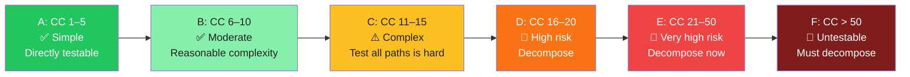

**Why CC predicts defect density:** CC is a lower bound on the number of test cases needed to
cover every branch. CC=36 means at minimum 36 test paths. In practice, most are never tested,
so each branch is a dark corner where bugs hide.

**ExampleSDK CC grade distribution:**

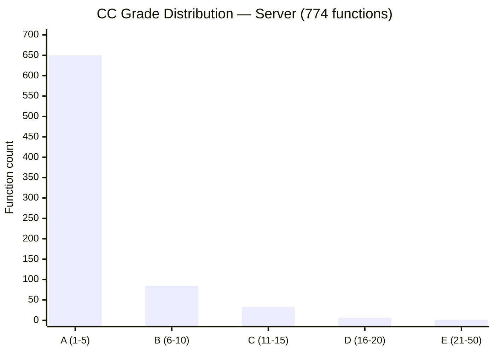

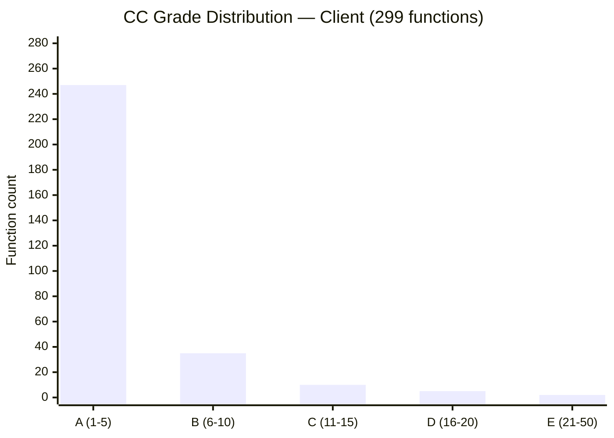

The distribution is healthy at the bulk (83–84% grade A), but the **maximum is grade E** in
both components — a single function raises the ceiling to CC=36 (server) and CC=40 (client).

---

### 2.4 ND — Nesting Depth

Every level of nesting adds a cognitive multiplication: to understand line N inside
three nested `if/for/with` blocks, you must hold all three surrounding conditions in your
head simultaneously.

```mermaid
graph TD
    subgraph "ND = 1 (simple)"
        D1["def fn():"]
        D2["    if x:"]
        D1 --> D2
    end

    subgraph "ND = 3 (moderate)"
        E1["def fn():"]
        E2["    for item in items:"]
        E3["        if item.valid:"]
        E4["            try:"]
        E5["                ...  ← ND 3"]
        E1 --> E2 --> E3 --> E4 --> E5
    end

    subgraph "ND = 5+ (danger zone)"
        F1["def fn():"]
        F2["    for item in items:"]
        F3["        if cond_a:"]
        F4["            for sub in item.subs:"]
        F5["                if cond_b:"]
        F6["                    try:"]
        F7["                        ...  ← ND 5 ⚠️"]
        F1 --> F2 --> F3 --> F4 --> F5 --> F6 --> F7
    end
```

`RabbitMQCache.is_ready` has ND=16 — this means 16 levels of nested conditionals.
That function requires holding 16 simultaneous conditions in working memory.

---

### 2.5 FLC — Function Length (Logic Lines)

"Logic lines" (LL) = non-blank, non-comment executable lines. This strips noise and
counts real cognitive work.

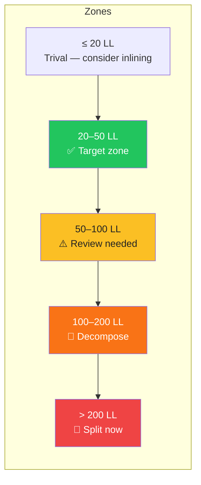

**Why > 100 LL is a firm gate:** A 100-LL function cannot be read in a single glance.
It requires scrolling, which breaks working-memory continuity. Functions this large almost
always contain multiple independent concerns that should be named and extracted.

**ExampleSDK worst offenders:**

| Function | Component | LL | CC | Issue |
|----------|-----------|----|----|-------|
| `_async_start_server` | server | **578** | 22 | Entire server startup inlined |
| `_dds_exam_patient_import_cb` | server | 293 | 12 | Import protocol in one callback |
| `receive_file` | client | 179 | **40** | Protocol state machine inlined |
| `run_server` | server | 165 | 25 | Startup orchestration inlined |

---

### 2.6 TCC — Temporal Coupling Count

TCC counts ordering edges that are **state/effect-mediated and invisible in signatures**.
These are the hidden "call A before B or it breaks" contracts.

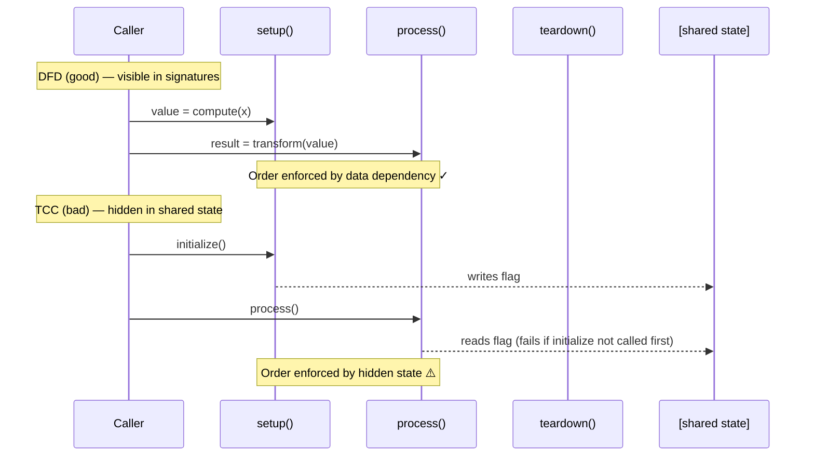

**Disambiguation test:** *"If I pass every value explicitly as a parameter, does reordering
still break behavior?"* — **Yes → TCC**, **No → DFD**.

---

### 2.7 The Coupling Lattice

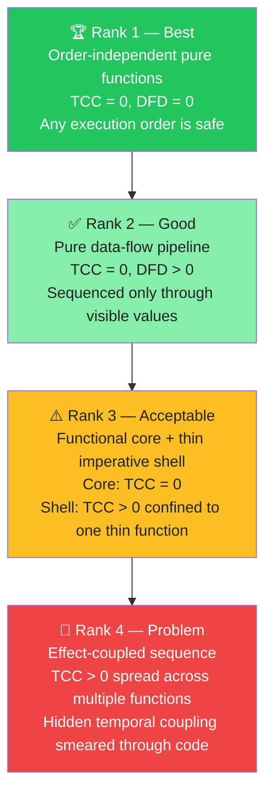

The **goal architecture is Rank 3**: a pure functional core (all decisions, all domain logic)
behind a thin imperative shell (the only place I/O, DB, time, and logging happen).

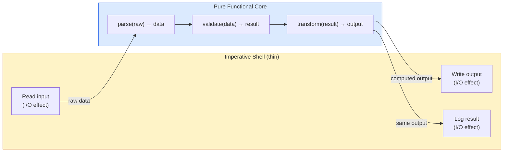

---

## 3. Deep Modules — Interface Cost Metrics

The core insight: **interface cost is paid by every caller, forever**. Implementation cost
is paid once by the author. Deep modules maximize functionality relative to interface cost.

$$Depth \approx \frac{Capability}{InterfaceCost}$$

$$InterfaceCost = ISC + ILC + RCK + CHEC$$

### 3.1 The Four Cost Components

> **Key framing:** ISC, ILC, RCK, CHEC are **scored by enumeration**, not computed automatically.
> You list named line-items, then count them: `ISC: [entry-point foo(); param X; config knob Y] = 3`.
> The computed metrics in §3.1.5 are *statistical proxies* that correlate with each component.

#### 3.1.1 Counting procedure and precedence

Every interface item is assigned to the **first** matching bucket — this prevents double-counting:

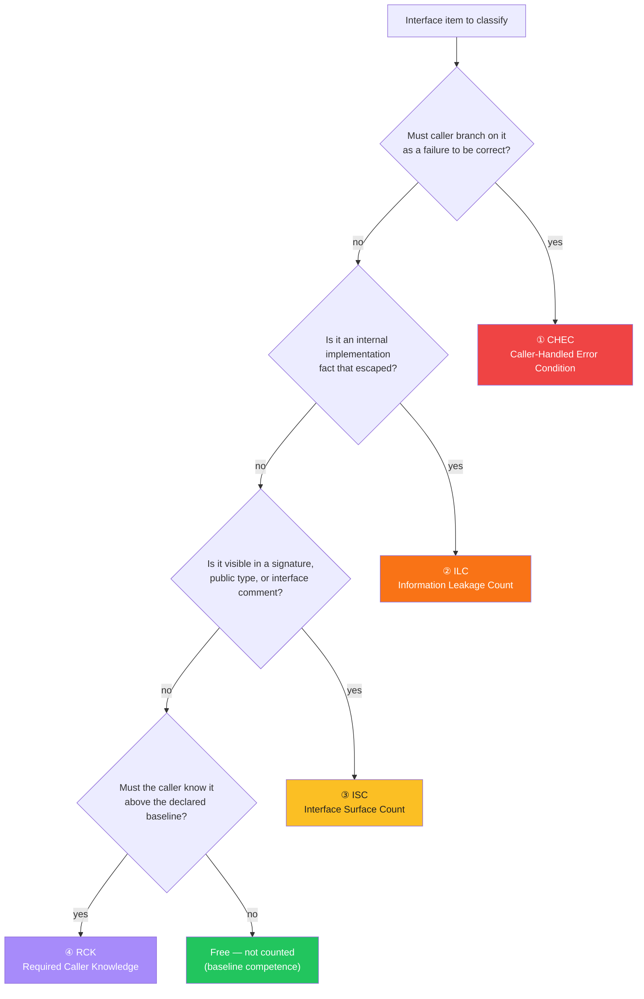

---

#### 3.1.2 CHEC — Caller-Handled Error Conditions (bucket 1)

**Counts:** distinct failure/error variants the caller must branch on to be correct.

```mermaid
graph LR
    subgraph "CHEC = 3 (expensive)"
        M1["module.get(key)"]
        E1["KeyError<br/>→ caller handles: retry"]
        E2["TimeoutError<br/>→ caller handles: backoff"]
        E3["ValidationError<br/>→ caller handles: log + skip"]
        M1 --> E1
        M1 --> E2
        M1 --> E3
    end

    subgraph "CHEC = 1 (better)"]
        M2["module.get(key)"]
        E4["ServiceError(code)<br/>→ one handler, code decides action"]
        M2 --> E4
    end

    style E1 fill:#ef4444,color:#fff
    style E2 fill:#ef4444,color:#fff
    style E3 fill:#ef4444,color:#fff
    style E4 fill:#22c55e,color:#fff
```

**What reduces CHEC:** Absorb recoverable errors internally. Wrap multiple internal error types into one typed error the caller can act on. Errors the module resolves internally are never counted.

**Computed proxies:**
- `opaque_raise_ratio` — fraction of raises whose exception type is not statically recoverable by the caller (high = high hidden CHEC)
- `undocumented_raise_fn_ratio` — raise-bearing functions missing a `Raises:` docstring (caller can't even discover the CHEC)

---

#### 3.1.3 ILC — Information Leakage Count (bucket 2)

**Counts:** internal implementation facts that escaped into the interface.

| ILC sub-type | What escaped | Example |
|---|---|---|
| **Type leak** | Storage/wire type is in the signature | Return type is `sqlite3.Row` not `dict` |
| **Decision duplication** | The same decision is encoded on both sides of the boundary | Caller must know your internal topic name `loc.tool.status_stream.*` |
| **Pass-through** | Method adds no value; just wraps a lower-level call | `Forwarder.send()` → `self._transport.send()` |
| **Temporal split** | A single knowledge unit was split at the wrong boundary (read / modify / write) | Caller must call `read()` then `process()` then `write()` for what should be one operation |
| **Framework detail** | Internal infrastructure visible to the caller | Queue names, connection strings, HTTP internals |

**Derived count — CA (Change Amplification):** how many distinct sites must you edit for one logical change? `CA > 1` means ILC is present.

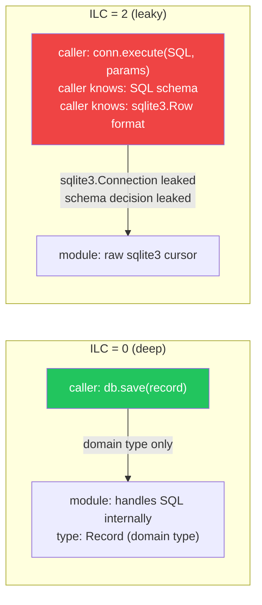

**Computed proxies:**
- `signature_infra_leak_ratio` — fraction of functions with infrastructure types (`RabbitMQ`, `sqlite3.Connection`, `asyncio.Queue`) in their signatures
- `signature_private_leak_count` — count of `_`-prefixed private types exposed in public signatures

---

#### 3.1.4 ISC — Interface Surface Count (bucket 3)

**Counts:** distinct *concepts* (not signature slots) a correct caller must supply or understand.

> **Critical rule — count concepts, not slots.** A 10-field `ConnectionConfig` object passed as one parameter still counts as the number of fields the caller must reason about. Collapsing params into a struct doesn't make a module deep.

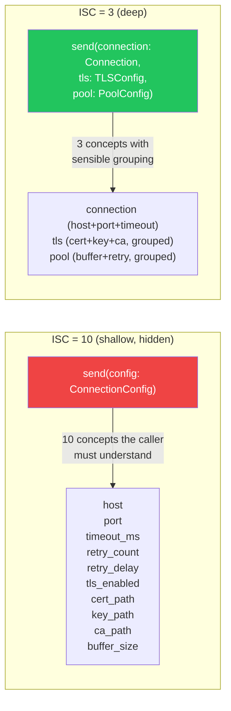

**What gets enumerated for ISC:**
- Each entry point (public method/function)
- Each distinct parameter concept (not each token)
- Each config knob with observable behavioral effect
- Each distinct success-return shape the caller branches on

**Honest ISC test:** "Can I write the complete interface contract in one short sentence?" The number of meaningful clauses ≈ ISC.

**Computed proxies:**
- `isc` — count of non-private public names (approximation; overcounts thin wrappers)
- `interface_density` = `isc / (total_ll / 100)` — depth signal (< 2 deep, > 15 shallow)
- `ic_max` / `ic_mean` — weighted call-shape complexity: `pos_required×2.0 + kwonly_required×1.25 + optional×0.5 + union_params×0.75 + kwargs×3.0`
- `pos_required_max`, `functions_over_5_posreq` — flags on required positional params
- `params_over_6_count` — total params exceeding 6

---

#### 3.1.5 RCK — Required Caller Knowledge (bucket 4)

**Counts:** things a correct caller must know that are NOT in the signature, NOT CHEC/ILC, and NOT in the declared baseline.

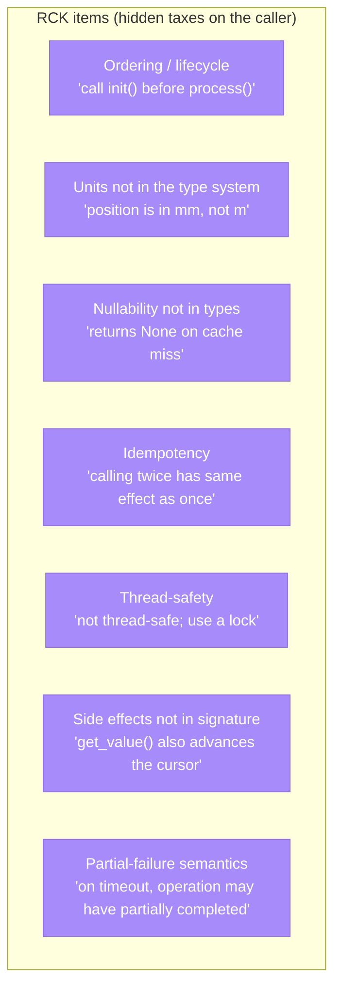

**Baseline is free and never counted.** Declare the caller's baseline explicitly (e.g., "general developer familiar with Python, JSON, HTTP"). Only module-specific knowledge above that baseline counts.

**Two reducers push RCK toward zero:**
- **Shared vocabulary** — express contracts in terms the caller already knows (SQL, semver, HTTP status codes, file paths)
- **Discoverability** — if the caller can query the fact at runtime (schema endpoint, `--help` flag), it's fetched not carried → not RCK

**Computed proxies:**
- `undeclared_temporal_contract_count` — the ordering/lifecycle sub-class: init-guarded call sites missing a `Preconditions:` docstring
- `annotation_coverage` — high annotation coverage *reduces* RCK by making types visible in signatures

---

#### 3.1.6 Computed metrics → component mapping

| Computed metric | Primary component | What it measures computationally | Automatable? |
|---|---|---|---|
| `isc` | ISC | Non-private public name count | ✅ fully |
| `interface_density` | ISC | `isc / (total_ll / 100)` | ✅ fully |
| `ic_max` / `ic_mean` | ISC | Weighted call-shape complexity | ✅ fully |
| `pos_required_max` | ISC | Max positional-required params | ✅ fully |
| `functions_over_5_posreq` | ISC | Functions with >5 posreq params | ✅ fully |
| `params_over_6_count` | ISC | Functions with >6 total params | ✅ fully |
| `signature_infra_leak_ratio` | ILC | Infra types in public signatures | ✅ fully |
| `signature_private_leak_count` | ILC | `_`-private types in public sigs | ✅ fully |
| `opaque_raise_ratio` | CHEC | Raises not statically recoverable | ✅ fully |
| `undocumented_raise_fn_ratio` | CHEC + RCK | Raises missing `Raises:` docstring | ✅ fully |
| `undeclared_temporal_contract_count` | RCK | Init-guarded sites missing `Preconditions:` | ✅ fully |
| `annotation_coverage` | RCK (reducer) | Typed slots make contracts visible | ✅ fully |
| CHEC score (qualitative) | CHEC | Enumerated error variants caller handles | ⚠️ judgment |
| ILC score (qualitative) | ILC | Enumerated escaped implementation facts | ⚠️ judgment |
| ISC score (qualitative) | ISC | Enumerated caller concepts (not slots) | ⚠️ judgment |
| RCK score (qualitative) | RCK | Enumerated undeclared caller knowledge | ⚠️ judgment |

### 3.2 Deep vs Shallow — Visual

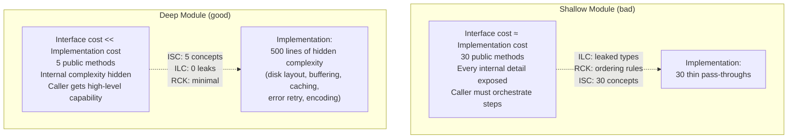

### 3.3 Import Graph — Fan-in, Fan-out, Instability

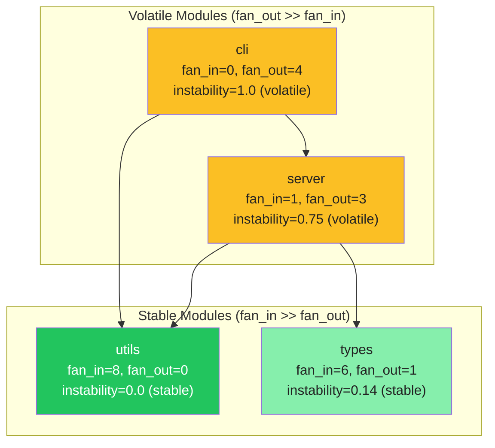

$$instability(M) = \frac{fan\_out(M)}{fan\_in(M) + fan\_out(M)}$$

- **Instability = 0** → fully stable (nothing it depends on can change without its knowledge)
- **Instability = 1** → fully volatile (depends on others, nothing depends on it)
- **SDP (Stable Dependencies Principle)**: stable modules should only depend on other stable modules.
  An SDP violation occurs when a module with low instability depends on a module with high instability.

**ExampleSDK current values:**
- Server: avg instability 0.528, max fan_out 3, **0 import cycles** ✓
- Client: avg instability 0.528, max fan_out 2, **0 import cycles** ✓

### 3.4 Import Cycles — Why Zero is the Target

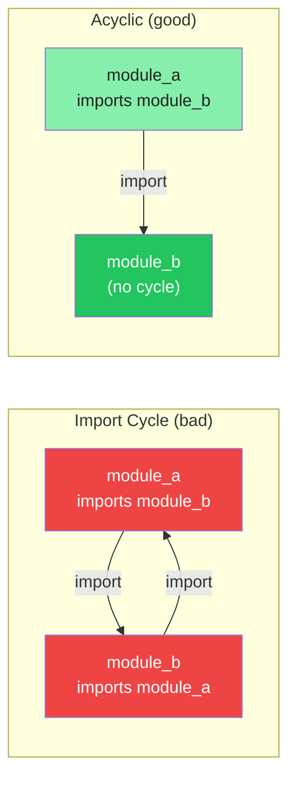

Cycles mean the modules cannot be changed independently — fixing a bug in A may require
changing B, which requires changing A again. Cycles also break incremental loading,
complicate testing, and prevent extracting either module to its own package.

### 3.5 Interface Density

$$interface\_density = \frac{ISC}{total\_LL / 100}$$

| Value | Signal |
|-------|--------|
| < 2 | **Deep** — few public names per 100 LL of implementation |
| 2–15 | Moderate |
| > 15 | **Shallow** — nearly as many public names as implementation lines |

A module with 500 LL and 4 public methods has density = 0.8 → **deep**.
A module with 50 LL and 30 public methods has density = 60 → **extremely shallow**.

---

## 4. Lean Design Metrics

### 4.1 params_over_6_count

Functions with more than 6 combined parameters signal two things:
1. The function is doing too much (violates single-responsibility)
2. The interface is hard to call correctly (caller must remember parameter order)

```mermaid
graph LR
    subgraph "Bad — 14 params"
        F1["__init__(self, host, port, timeout,<br/>retry_count, retry_delay, tls,<br/>cert_path, key_path, ca_path,<br/>buffer_size, max_connections,<br/>heartbeat_interval, username, password)"]
    end

    subgraph "Better — grouped concepts"
        F2["__init__(self, connection: ConnectionConfig,<br/>tls: TLSConfig,<br/>pool: PoolConfig)"]
    end

    style F1 fill:#ef4444,color:#fff
    style F2 fill:#22c55e,color:#fff
```

**ExampleSDK offenders:** `CycloneDDSMessaging.__init__` has 14 params — the worst in the codebase.

### 4.2 annotation_coverage

Type annotations serve as machine-checked documentation. High coverage means:
- IDEs can provide accurate autocomplete and type-checking
- Callers can understand what's expected without reading the body
- Tools like mypy can catch type errors before runtime

$$annotation\_coverage = \frac{\text{annotated parameter+return slots}}{\text{total parameter+return slots}}$$

**ExampleSDK:** Server 89.3%, Client 92.3% — both are in the **good** range.

### 4.3 dead_export_count

Public names with zero references in `src/` + `tests/`. These are interface surface that
callers never use but must still learn about, understand, and maintain.

```mermaid
graph LR
    E1["Public API<br/>of module X"] --> U1["Used by<br/>caller A"]
    E1 --> U2["Used by<br/>caller B"]
    E1 --> D1["💀 dead_export<br/>No references anywhere<br/>Must still be maintained<br/>Should be removed or made private"]

    style D1 fill:#6b7280,color:#fff
```

*(Not yet computed for ExampleSDK — requires cross-file reference tracking.)*

---

## 5. All Metrics at a Glance

```mermaid
graph TB
    subgraph FC["Functional Core metrics (function body)"]
        direction LR
        P["PLR own/deep<br/>Purity ratio<br/>↑ higher is better<br/>Firm gate ≥0.80"]
        CC["CC max / df_count<br/>Cyclomatic complexity<br/>↓ lower is better<br/>Firm gate ≤10 max"]
        ND["ND max<br/>Nesting depth<br/>↓ lower is better<br/>Firm gate ≤5"]
        FLC["FLC max LL<br/>Function length<br/>↓ lower is better<br/>Firm gate ≤100"]
        F100["functions_over_100ll<br/>Big function count<br/>↓ lower is better<br/>Firm gate → 0"]
    end

    subgraph DM["Deep Modules metrics (module boundary)"]
        direction LR
        IC["import_cycles<br/>Coupling cycles<br/>↓ firm gate → 0"]
        FO["max_fan_out<br/>Efferent coupling<br/>↓ advisory"]
        IST["instability<br/>Stability 0→1<br/>Descriptor"]
        AC["annotation_coverage<br/>Type completeness<br/>↑ advisory ≥0.80"]
        ID["interface_density<br/>Depth signal<br/>< 2 deep<br/>> 15 shallow"]
    end

    subgraph LD["Lean Design metrics (whole codebase)"]
        direction LR
        P6["params_over_6_count<br/>Fat signatures<br/>↓ firm gate → 0"]
        DE["dead_export_count<br/>Unused public names<br/>↓ firm gate → 0"]
        UTC["undeclared_temporal_contracts<br/>Missing preconditions<br/>↓ firm gate → 0"]
    end
```

---

## 6. Reading the ExampleSDK Scorecards

### Server Overall

```mermaid
xychart-beta horizontal
    title "Server — Metric Health (% of green target achieved)"
    x-axis ["PLR own (0.745/0.80)", "PLR deep (0.221/0.60)", "CC max inv (1-36/50)", "ND max inv (1-17/20)", "FLC max inv (1-578/600)", "Ann. coverage (0.893/1.0)"]
    y-axis "% toward green" 0 --> 100
    bar [93, 37, 28, 15, 4, 89]
```

### Client Overall

```mermaid
xychart-beta horizontal
    title "Client — Metric Health (% of green target achieved)"
    x-axis ["PLR own (0.614/0.80)", "PLR deep (0.277/0.60)", "CC max inv (1-40/50)", "ND max inv (1-7/20)", "FLC max inv (1-179/200)", "Ann. coverage (0.923/1.0)"]
    y-axis "% toward green" 0 --> 100
    bar [77, 46, 20, 65, 11, 92]
```

---

## 7. Where to Focus — Risk Matrix

```mermaid
quadrantChart
    title Hotspot Risk Matrix (ExampleSDK Server)
    x-axis "Low Complexity" --> "High Complexity"
    y-axis "Low Risk" --> "High Risk"
    quadrant-1 Urgent decompose
    quadrant-2 Monitor
    quadrant-3 Healthy
    quadrant-4 Document but ok

    RabbitMQCache.handle_message: [0.95, 0.95]
    _async_start_server: [0.85, 0.80]
    run_server: [0.75, 0.65]
    DataItemTransport.handle_request: [0.70, 0.60]
    build_registration: [0.65, 0.55]
    Forwarder._dds_exam_patient_import_cb: [0.60, 0.70]
    RabbitMQCache.__init__: [0.30, 0.60]
    dataitem.builders: [0.40, 0.40]
```

---

## 8. Improvement Playbook

The metrics tell you *where* to look; this tells you *what to do*.

### When PLR is low → Extract a pure core

```mermaid
graph LR
    subgraph Before["Before: effects mixed in"]
        B1["def process(data):<br/>  log.info('start')          # effect<br/>  validated = validate(data)  # pure logic<br/>  db.save(validated)          # effect<br/>  return validated            # mixed"]
    end

    subgraph After["After: functional core / imperative shell"]
        A1["def _process_pure(data):<br/>  return validate(data)  # pure ✓<br/><br/>def process(data):          # shell<br/>  log.info('start')      # effect<br/>  result = _process_pure(data)<br/>  db.save(result)        # effect<br/>  return result"]
    end

    Before -->|Extract pure core| After
    style Before fill:#fef3c7
    style After fill:#dcfce7
```

### When CC is high → Replace dispatch switch with typed handlers

```mermaid
graph TB
    subgraph Before["Before: one fat dispatcher (CC=36)"]
        D["def handle_message(msg):<br/>  if msg.type == 'A': ...<br/>  elif msg.type == 'B': ...<br/>  elif msg.type == 'C': ...<br/>  ... (33 more branches)"]
    end

    subgraph After["After: typed handlers (each CC=1-3)"]
        R["HANDLER_MAP = {<br/>  'A': handle_a,<br/>  'B': handle_b,<br/>  'C': handle_c,<br/>  ...<br/>}<br/><br/>def handle_message(msg):<br/>  return HANDLER_MAP[msg.type](msg)"]
        H1["def handle_a(msg): ...  # CC=1-3"]
        H2["def handle_b(msg): ...  # CC=1-3"]
        H3["def handle_c(msg): ...  # CC=1-3"]
        R --> H1
        R --> H2
        R --> H3
    end

    Before -->|Decompose dispatcher| After
    style Before fill:#fef3c7
    style After fill:#dcfce7
```

### When FLC is high → Named startup phases

```mermaid
graph LR
    subgraph Before["_async_start_server (578 LL)"]
        M["one giant function<br/>with all startup logic inline"]
    end

    subgraph After["Named phases"]
        P1["_configure_transport()"]
        P2["_start_rmq_cache()"]
        P3["_initialize_bridge()"]
        P4["_bind_slp_port()"]
        P5["_register_services()"]
        P1 --> P2 --> P3 --> P4 --> P5
    end

    Before -->|Extract named phases| After
    style Before fill:#fef3c7
    style After fill:#dcfce7
```

---

## 9. Metric Gates Reference

| Metric | Gate type | Threshold | Current server | Current client |
|--------|-----------|-----------|----------------|----------------|
| `plr_own` | firm | ≥ 0.80 | ⚠️ 0.745 | 🚨 0.614 |
| `plr_deep` | firm | ≥ 0.60 | 🚨 0.221 | 🚨 0.277 |
| `cc_max` | firm | ≤ 10 | 🚨 36 | 🚨 40 |
| `cc_df_count` | firm | = 0 | 🚨 7 | 🚨 7 |
| `nd_max` | firm | ≤ 5 | 🚨 17 | ⚠️ 7 |
| `flc_max_ll` | firm | ≤ 100 | 🚨 578 | 🚨 179 |
| `functions_over_100ll` | firm | = 0 | 🚨 16 | ⚠️ 5 |
| `import_cycles` | firm | = 0 | ✅ 0 | ✅ 0 |
| `max_fan_out` | advisory | ≤ 10 | ✅ 3 | ✅ 2 |
| `annotation_coverage` | advisory | ≥ 0.80 | ✅ 0.893 | ✅ 0.923 |
| `params_over_6_count` | firm | = 0 | ⚠️ 9 | ⚠️ 8 |

> **Gate types**: `firm` = CI blocks on regression; `advisory` = warning only; `descriptor` = informational, no gate.
