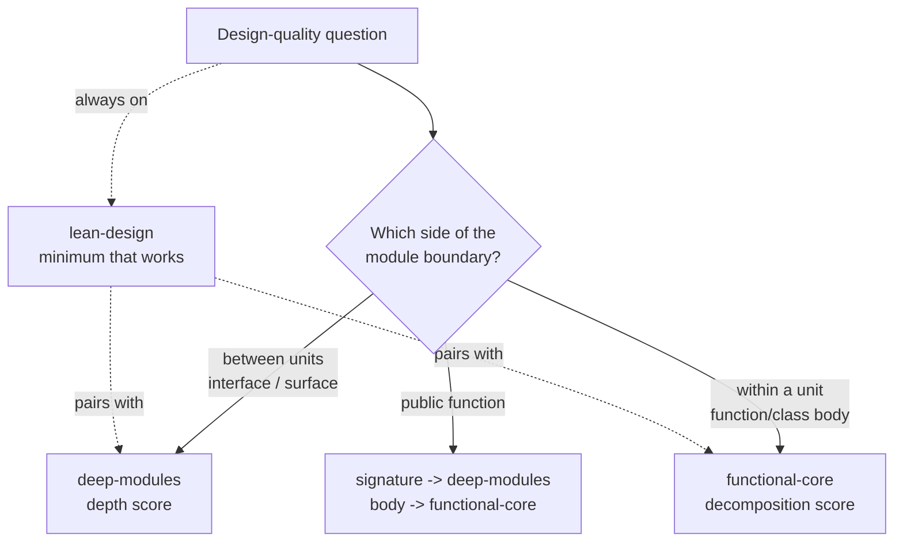

# Design Rubrics -- router & shared contract

Three rubrics judge design quality. They divide along **one scope axis plus one ambient
bound** -- not three peers. Pick by asking *which side of the module boundary the question
lives on.*

## Which rubric? (route here first)

| Your question is about... | Side of boundary | Use | It emits |
|---|---|---|---|
| an interface, API, CLI, folder/contract surface -- anything a *caller* consumes | **between** units | [`deep-modules`](../deep-modules/SKILL.md) | a comparative **depth score** + verdict |
| a function/class **body** -- purity, decomposition, complexity, temporal coupling | **within** a unit | [`functional-core`](../functional-core/SKILL.md) | a comparative **decomposition score** + verdict |
| a *file/module* that has accreted multiple responsibilities -- "should this file be split?" | **within** a unit (coarser) | [`functional-core`](../functional-core/SKILL.md) § **RCC trigger heuristic** | a decomposition trigger (RCC >= K) + anti-overcorrection validation via all three rubrics |
| "is this the minimum that works?" -- speculative layers, ceremony, over-build | **every scale** (ambient) | [`lean-design`](../lean-design/SKILL.md) | an **auditable decision** (rung -> stop) |

**A sibling gate, not a fourth rubric.** Before any of the three rubrics above is asked to score a `CONTRACT-*` design choice, a distinct question must already be answered: does this choice need to be written into the plan's Contracts section at all, or may it safely be left to the Implementer? That gate -- the **Propagation Test** -- is owned by [`no-silent-assumptions-software-planning`](../no-silent-assumptions-software-planning/SKILL.md#propagation-test), not by this router; it decides definition-completeness (what must be captured in writing), while this file's three rubrics decide framing quality (how an already-surfaced comparison is scored). The five-probe table itself is not duplicated here -- see the linked section for the canonical version.

**Three rules that resolve every overlap:**

1. **deep XOR functional.** A single question sits on one side of the boundary. They never
   score the *same* question. Decomposing a *private* function never changes a `deep-modules`
   verdict; sizing a *public interface* never changes a `functional-core` verdict.
2. **lean is always on, and pairs with whichever scope rubric is active.** `deep+lean` and
   `functional+lean` are normal; `deep+functional` is not.
3. **Reuse never shrinks a declared surface.** Lean rung 2 (reuse an existing seam) is a
   below-the-facade decision: existing plumbing may *fulfill* a capability, never *redefine*
   it. If a "reuse" answer would reduce what a caller-visible surface delivers, the question
   is deep-modules (capability equivalence = No), not a lean trim -- and hazard probe P3 fires.

> **Emission contract:** Even when routing directly to a leaf rubric, the agent MUST emit using the shared **Compact decision template** ([§ Compact decision template](#compact-decision-template)) before producing a verdict.

**Necessary, not sufficient -- seam-fidelity is orthogonal to all three rubrics.** These rubrics score
the *shape* of a boundary; none of them validates that the boundary you are scoring actually
*exists in the code*, that an emit-point / extension-point is real, or that a shared signal has
exactly one owner. For any design that touches >=2 existing seams, pair the rubric verdict with a
**seam-validation** pass (read the live code, confirm emit-points, confirm single ownership, confirm
dependency order). A clean depth score has been shipped over a non-existent seam -- keep scoring and
seam-validation as distinct activities.

**The one shared artifact -- a public function.** Its **signature** is a `deep-modules` question;
its **body** is a `functional-core` question. That is two questions about one artifact, answered
by two rubrics -- not a conflict. Score the signature with deep, the body with functional.



## The shared judgment spine (all three emit this)

The three rubrics differ in instrument (`deep-modules` and `functional-core` emit a comparative
*score*; `lean-design` emits a *decision*) but share one **output contract**, because the same
three disciplines are what make a judgment auditable and adherence-checkable. Every rubric
output states:

1. **Convention named** -- the basis the verdict is computed against.
2. **Items listed** -- the concrete facts behind the judgment (never assert a verdict bare).
3. **Confidence / proportionality** -- so false certainty is visible.
4. **Blind spot named** -- what the verdict does **not** establish. An auditable count can be clean
   yet blind: a `deep-modules` verdict scores whether a surface is *justified*, not whether the
   chosen seam *exists in code* or has a single owner; a `functional-core`/oracle verdict can pass
   on absent data (a "correct sort" that holds only because every parsed value is NULL). State the
   limit so a clean verdict is not mistaken for a complete one. (See the seam-fidelity caveat below.)

See the contract table below for each rubric's instantiation.

## Shared output contract -- the auditable-judgment spine

| Discipline | deep-modules | functional-core | lean-design |
|---|---|---|---|
| **1. Name the convention** | caller + baseline; capability held constant; equivalence (Yes / Shared-only / Normalized) | effect-policy (by hash) + region (files/fns) + behavior-equivalence | **zone** (runtime/contract vs tooling) |
| **2. List the items behind the judgment** | the line items behind ISC / ILC / RCK / CHEC | the items behind PLR / FLC-max / CC-max / ND-max / TCC | **rung reached + why it held + what was skipped + guardrail status** |
| **3. State confidence / proportionality** | High / Medium / Low + why | High / Medium / Low + why | proportionate trace (Medium default); explanation never longer than the change |
| **Skill-specific output** | comparative **depth verdict** (A vs B, lower InterfaceCost wins) | comparative **decomposition verdict** (full-vector dominance) | a **decision** (build / reuse seam / don't build) + `DEFER-<id>` per deliberate cut |

**Read this honestly:** two of the three additionally produce a *comparative score* because they
answer an A-vs-B question; `lean-design` answers a *generative* question (build / reuse / skip)
and so produces a decision, not a score. Forcing a proxy vector onto lean would manufacture
numbers with no referent -- which lean's own rung 1 ("does this need to exist?") forbids.
**Consistency lives in the three shared disciplines, not in a uniform instrument.**

### Lens Applicability declaration {#lens-applicability-declaration}

Every user-facing option comparison — blocking and non-blocking `OPENQ-*` items, `ALT-*` rejection
rationales, and any plan section or response presenting two or more options — **MUST** carry this
line as its **required first line**:

```
Lens[DM<+|-(reason)> FC<+|-(reason)> LD<+|-(reason)>]
```

Reason is **required** immediately after `` `-` `` (in parentheses, e.g.
`` `FC-(not a within-unit decomposition)` ``), **optional** after `` `+` `` (the `+` lens is
exercised in its own scorecard and its reasoning surfaces there).

**Derivation invariant (C1) — the line is a rendered projection of the Stage-2 classifier type,
not an independent judgment or a third classifier bucket:**

| Stage-2 classifier type | deep-modules | functional-core | lean-design |
|---|---|---|---|
| interface-shaping | `+` | `-` (constant — see below) | `+` |
| scope/policy | `-(no caller/surface interface; scope/policy)` | `-` (constant — see below) | `+` |

`deep-modules` and `lean-design` tokens are a **rendered projection** of the Stage-2 classifier
type; they can never disagree with the classifier. `functional-core` is a **constant `` `-` ``** in
this domain (planning-time user-facing OPENQs): within-unit decomposition is out of the
classifier's scope by definition (see Classifier scope note in the OPENQ-framing section below).
Its **fixed canned token** — use this exact string, do not paraphrase:

> `FC-(not a within-unit decomposition)`

This token is a completeness marker: it proves the lens was considered and dismissed, not
forgotten. A genuine decomposition trade-off belongs to
[`functional-core`](../functional-core/SKILL.md) at implementation time, outside this line.
There is no `FC+` within this domain.

**Capability Admission Record override.** Inside a `## Capability Admission Record` (required by a
project's capability-admission-ladder ADR, e.g. example-mcp's ADR-EXAMPLEMCP-032, when the project has
one), `` `-` `` is not a legal token for `deep-modules` or `lean-design` — both always apply to
capability admission: the ladder itself is the lean ladder walked against a new capability, and
Rung 3/4 require the deep-modules scorecard when an extension is compared against a new primitive.
`functional-core` keeps its constant `` `-` `` token unchanged (it is still a within-unit question). A
CAR carrying `` `DM-` `` or `` `LD-` `` on any of its rungs is incomplete.

**Verbosity-vs-auditability rationale (inline — per Architect ruling; no ADR):** Silence on an
inapplicable lens is indistinguishable from forgetting it. One required line per comparison makes
omission visible and auditable without additional verdicts. Dismissed lenses carry a one-clause
reason proving they were considered rather than overlooked; reason is optional on `` `+` `` because the
exercised lens surfaces its own reasoning in its scorecard. The `` `FC-` `` constant is
honestly boilerplate — its value is audible dismissal at zero extra judgment cost.

> **Single canonical format:** The format string above is stated **once** — here, in
> this section. Every other location in this file and in all referencing skills and agents uses a
> **slot reference** (anchor link + the words "Lens applicability") — never a restatement of the
> format string.

## Framing an impactful decision

When surfacing a non-trivial open question or design choice, present the options as a
**deep/lean mini-scorecard**: the relevant subset of `ISC/ILC/RCK/CHEC` (for interface-boundary
decisions) and/or the lean ladder (for build-vs-skip decisions). Apply the same three disciplines
from the shared spine above.

**Guardrail -- proportionality:** apply this framing **whenever you present two or more options to a user**. Proportionality governs *format*, not whether to frame: a trivial or capability-equivalent pick collapses to `Verdict: [option] — [one-line rationale]`; a non-trivial pick uses the full table. Omitting framing entirely because a decision feels "obvious" is the failure mode — the user can see rationale; they cannot see reasoning the agent omitted. (`lean-design`'s proportionality rule governs format choices.) A [Lens Applicability declaration](#lens-applicability-declaration) is required in all forms — including the collapsed one-liner — because it is itself one line and proportionality does not waive it.

### Hazard probe -- mandatory, pre-verdict

The four proxies measure **interface cost**, not runtime risk -- and the two can
anti-correlate. A latent failure mode with no caller error branch *lowers* CHEC and often
trims per-call parameters, so the scorecard can actively favor the more dangerous option
(observed: binding a mutable volume id at facade construction scored cheaper than per-write
passing while introducing a stale-binding failure mode -- a later write silently targets the
wrong volume). The hazard probe is the forced risk lens: run it on every option **before**
reading off totals.

| # | Probe | Fires when |
|---|---|---|
| P1 | **Lifetime asymmetry (stale binding)** | An option captures mutable state at construction/registration/subscription whose value can change within the holder's lifetime. Name the datum, its mutation events, and the holder's lifetime -- if a mutation event exists inside the lifetime, it fires. |
| P2 | **Validation displacement** | An option removes or relocates a per-operation validation opportunity away from the boundary that owns it (e.g., a server that guards the value can no longer see it per call). |
| P3 | **Guarantee cut in costume** | An option delivers less than the capability held constant in the gate -- equivalence is actually No. Frequent source: lean rung-2 "reuse" applied above the facade instead of below it (routing rule 3). |
| P4 | **Silent-failure conversion** | An option converts a detectable failure into silent success or a wrong-target effect. No caller error branch exists for the new hazard -- which is exactly why CHEC cannot see it. |

**Rules:**

- Every framing block (compact template, interface-shaping scorecard, scope/policy lean axes)
  carries a `Hazard:` line: per option, the firing probe + a one-line failure mode, or
  `none -- probes P1-P4 applied`.
- **Veto lane, not a column** (ADR-003 firewall intact): hazards are never summed into TOTAL.
  In the runtime/contract zone, a named unmitigated hazard defeats any interface-cost edge --
  the verdict must pick a hazard-free option, state the mitigation, or record acceptance.
- **Acceptance mints a guarantee.** Accepting a hazard (or overriding the proxy leader because
  of one) mints a candidate guarantee -- the hazard's negation -- per `requirements-enforcement`:
  one-line mint into `guarantees/LEDGER.md` if bootstrapped, else a plan-local candidate mode
  documented in the plan. Design-time near-misses feed the same ledger escapes do.
- **Trivial-collapse is illegal while any probe fires.** A named hazard makes the pick
  non-trivial by definition.
- The `Hazard:` line is the scorecard's instantiation of `lean-design`'s guardrail lens
  (trust-boundary, contract, oracle); the probes are the interface-decision subset. If a lean
  ladder trace is also emitted, the two must agree.
- **Sibling mechanism, not a substitute:** the hazard probe catches *discovered* runtime risk with
  no caller error branch. It does not check *declared* requirements an option could fail -- that is
  [`deep-modules`' Gate rows](../deep-modules/SKILL.md#trajectory-rows-required-in-every-comparison-scorecard)
  (`Satisfies <CON-ID>: yes/no`, cited to a pre-existing constraint). Run both: a clean hazard probe
  does not excuse a missing gate-row check, and vice versa.

### Compact decision template

```
Lens applicability: → [§Lens Applicability declaration](#lens-applicability-declaration)

## Decision: <short label>

Caller & baseline: <who decides + current state>
Capability held constant: <the outcome each option delivers>
Equivalence: Yes / Partial -- <why>
Growth unit: <the countable thing this requirement multiplies in, + current count if known --
             or "none -- one-off decision, no trajectory">
Confidence: High / Medium / Low -- <why>
Hazard: <per option: probe + one-line failure mode, or "none -- probes P1-P4 applied">

All proxies: lower is better; lean-rung / Growth-req: higher-is-worse for Growth-req.
(.) = leader; (+n) = points behind leader.
| Option   | CHEC | ILC | ISC | RCK | ‖ | TOTAL | ‖ | Growth/req    | Slope         | ‖ | Lean-rung (higher wins) | Attention |
|----------|-----:|----:|----:|----:|:-:|------:|:-:|:-------------:|:-------------:|:-:|------------------------:|:----------|
| Option A |      |     |     |     | ‖ |       | ‖ | n [Obs\|Proj] | flat/rising/… | ‖ |                         |           |
| Option B |      |     |     |     | ‖ |       | ‖ | n [Obs\|Proj] | flat/rising/… | ‖ |                         |           |
| Option C |      |     |     |     | ‖ |       | ‖ | n [Obs\|Proj] | flat/rising/… | ‖ |                         |           |

Verdict: <winner + one-line rationale -- or "trivial: [one-line]" for obvious picks>
[if bases and slopes both differ] Crossover: G* = <value | n/a -- one option dominates>;
  horizon <known: n | unknown, default = flatter option>.
```

*Include only the dimensions relevant to the decision. Omit lean-ladder row for pure
interface comparisons; omit ISC/CHEC for pure build-vs-skip decisions. Omit Growth/req + Slope
+ Crossover only when the header states `Growth unit: none` -- otherwise they are required, not
optional; see [`deep-modules` Trajectory rows](../deep-modules/SKILL.md#trajectory-rows-required-in-every-comparison-scorecard)
for the full growth-unit / Δ / slope / crossover mechanics this row summarizes.*

**When the decision *splits* shared work across >=2 units/plans, add an `Ownership` line:** each
shared signal/row/field must have exactly one owning unit for **both** its definition (kind) and its
emit-point. Shared *data* (a parsed column, a metadata table) may be consumed by many; shared
*definition* may not. A split definition is a leaky boundary (deep-modules scores it as ILC) and a
no-duplication test will not catch the *orphaned* case -- see [`deep-modules`](../deep-modules/SKILL.md)
guideline 4.

### OPENQ-framing mode (authoritative template)

> **Placement note (F-2 origin):** This template lives in `design-rubrics` -- not in
> `deep-modules` -- because the framing covers *both* interface-shaping and scope/policy
> questions. Lean cost axes for scope/policy questions do not belong in `deep-modules`'s
> between-units interface lane; co-locating them would create ILC between the two rubrics and
> invite drift. `design-rubrics` already owns the shared output contract and is the natural
> single source of truth. Other artifacts reference this section; they do not copy it.
> Worked examples demonstrating both branches are indexed in the
> [OPENQ Framing Example Index](#openq-framing-example-index) below.
>
> **Classifier scope note:** The classifier and this template govern **user-facing OPENQs**
> emitted at planning time. Within-unit decomposition decisions (should this function be split?)
> are out of scope here -- handle those with [`functional-core`](../functional-core/SKILL.md)
> at implementation time. This template's trigger context also explicitly includes an ADR's
> Considered-Options/Decision sections (see [`adr-authoring`](../adr-authoring/SKILL.md)) --
> not only a plan's `OPENQ-*`/`ALT-*` items.

This section is an **instantiation of the shared output contract / auditable-judgment spine** (see
table above): it applies the three shared disciplines -- name the convention, list the items behind
the judgment, state confidence -- to OPENQ framing at planning time.

**Gate-first guardrail:** Before scoring any interface-shaping OPENQ with the four proxies, run
the deep-modules gate (declare caller + baseline; confirm capability equivalence). A scorecard
without a declared gate produces confident-but-meaningless numbers. **Do NOT score pure
scope/policy questions with the four proxies** -- use the lean cost axes branch below.

Emit one compact framing block per OPENQ, depending on Stage-2 classifier output (see
[`no-silent-assumptions`](../no-silent-assumptions-software-planning/SKILL.md#stage-2-openq-classifier-post-gate-at-emission)):

#### Interface-shaping OPENQ -- compact scorecard

Run the deep-modules gate first. Fill the relevant-subset table (omit rows where the dimension
does not bear on the decision) and state a metrics-driven default:

```
Lens applicability: → [§Lens Applicability declaration](#lens-applicability-declaration)

Gate: Caller = <who consumes this surface>. Baseline = <what they already command>.
      Capability held constant = <the outcome both options deliver>. Equivalence: Yes / No.
Growth unit: <the countable thing this requirement multiplies in -- or "none -- one-off, no trajectory">
Confidence: High / Medium / Low -- <why; state Medium or Low when proxy counts are estimated>
Hazard: <per option: probe + one-line failure mode, or "none -- probes P1-P4 applied">

All proxies: lower is better. (.) = leader; (+n) = points behind leader.
| Option   | CHEC | ILC | ISC | RCK | ‖ | TOTAL | ‖ | Growth/req    | Slope         | Attention |
|----------|-----:|----:|----:|----:|:-:|------:|:-:|:-------------:|:-------------:|:----------|
| Option A |      |     |     |     | ‖ |       | ‖ | n [Obs\|Proj] | flat/rising/… |           |
| Option B |      |     |     |     | ‖ |       | ‖ | n [Obs\|Proj] | flat/rising/… |           |

Verdict: <winning option + one-line rationale; or "trivial: [one-line]" for an obvious pick>
[if bases and slopes both differ] Crossover: G* = <value | n/a -- one option dominates>;
  horizon <known: n | unknown, default = flatter option>.
```

*Include only the dimensions relevant to the decision; omit rows that do not bear on it. Omit
Growth/req + Slope + Crossover only when `Growth unit: none` is declared -- otherwise required.*

> **Firewall guardrail (ADR-003):** `TOTAL` is the sum of the **four scored proxies only**
> (`CHEC`, `ILC`, `ISC`, `RCK`) -- `InterfaceCost` remains the *only scored axis*. `Growth/req`,
> `Slope`, `CA`, and `CCT` are **non-summed derived signals**; they appear after `TOTAL` in a
> `‖`-separated column and are **never** added into `TOTAL`. `Growth/req` carries an
> `[Observed, n=3]` or `[Projected]` label (never blended, never omitted) and `Slope` is a *derived*
> band -- see [`deep-modules` Trajectory
> rows](../deep-modules/SKILL.md#trajectory-rows-required-in-every-comparison-scorecard) for the
> full counting convention and the crossover formula. Being derived does not make trajectory a
> Block-3 factor: it is a *durable per-caller* cost, so a trajectory-vs-today divergence is resolved
> **inside the verdict** by crossover arithmetic, never by the Block-3 override gate (which exists
> solely for *one-time* costs and keeps its `gap <= 1` window). The `Attention` column restates only
> Block-1 (counts) or Block-2 (depth-verdict) content; it **must not** surface Block-3 material --
> one-time / transition / migration / schedule / risk costs -- into the scorecard table. See ADR-003.

#### Scope/policy OPENQ -- lean cost axes (no four-proxy table)

**Do NOT use the four proxies here.** Apply lean cost axes only:

```
Lens applicability: → [§Lens Applicability declaration](#lens-applicability-declaration)

Lean axes: AuthorCost = <one-time author cost>;
           Transition cost = <migration / churn cost>;
           Growth unit = <the countable thing this requirement multiplies in -- or "none">;
           Marginal surface / trajectory = <Δ per growth unit, labeled [Observed, n=3] or
             [Projected], per option> -> Slope = <flat | rising (linear) | rising (steep, Nx)
             | compounding (driver)> -> [if bases+slopes differ] Crossover G* = <value>;
             horizon <known: n | unknown, default = flatter option>;
           Capability-equivalence gate: <do options deliver the same capability -- yes/no + why>
Confidence: High / Medium / Low
Hazard: <per option: probe + one-line failure mode, or "none -- probes P1-P4 applied">
```

*Full growth-unit / Δ / slope / crossover mechanics and counting convention (Observed-preferred,
Projected-fallback, never blended) live in [`deep-modules` Trajectory
rows](../deep-modules/SKILL.md#trajectory-rows-required-in-every-comparison-scorecard) -- this
axis reuses that machinery even though it is a scope/policy question, because the countability of
growth is a property of the requirement, not of which rubric is scoring it.*

### OPENQ Framing Example Index

> **Note:** These are **OPENQ-framing** worked examples -- they demonstrate how to classify and
> frame an OPENQ at planning time (interface-shaping vs scope/policy, gate, scorecard or lean
> axes, verdict). They are distinct from [`deep-modules/examples/`](../deep-modules/examples/)
> which are **depth-scoring** examples demonstrating how to compare two designs with the
> ISC/ILC/RCK/CHEC scorecard. Do not conflate the two sibling example trees.

Examples are loaded on demand; they are not required reading to apply the framing template.
Each example demonstrates one distinct point.

| # | Title | Category | What it demonstrates |
|---|-------|----------|----------------------|
| 1 | Skill loading: one entry point vs per-mode | Happy-path, interface-shaping | Clean interface-shaping framing: gate fires cleanly, proxy counts produce a decisive verdict. |
| 2 | Example corpus: single home vs split | Happy-path, scope/policy | Clean scope/policy framing: lean cost axes only; trajectory analysis drives the verdict. |
| 3 | Agent output contract: normalized equivalence | Variation | "Shared-only" gate: when B adds extra capabilities, score shared capability only and recommend unbundling. |
| 4 | Backcompat shim: include or defer? | Variation | Scope/policy with trajectory: the shim's falling marginal cost vs rising transition obligation. |
| 5 | Looks interface-shaping, actually scope/policy | Ambiguous edge case | Capability-equivalence gate catches a misclassification -- four proxies would produce meaningless numbers. |
| 6 | High-blast scope/policy (deprecation posture) | Ambiguous edge case | High blast-radius does not imply interface-shaping; lean cost axes apply even under high blast. |
| 7 | Trivial pick collapses to one-liner | Ambiguous edge case | Proportionality guardrail: when L2 dominance is clear, collapse to ASSUMPTION-* -- do not emit a full framing block. |

Full files: [examples/01-skill-loading-granularity.md](examples/01-skill-loading-granularity.md) | [examples/02-example-corpus-location.md](examples/02-example-corpus-location.md) | [examples/03-agent-output-contract-normalized.md](examples/03-agent-output-contract-normalized.md) | [examples/04-backcompat-shim-scope.md](examples/04-backcompat-shim-scope.md) | [examples/05-looks-interface-but-is-policy.md](examples/05-looks-interface-but-is-policy.md) | [examples/06-high-blast-scope-policy.md](examples/06-high-blast-scope-policy.md) | [examples/07-trivial-one-liner-collapse.md](examples/07-trivial-one-liner-collapse.md)

## Boundaries

This skill **routes and defines the shared output contract**. It does **not** restate the
rubrics -- depth counting lives in `deep-modules`, the proxy vector in `functional-core`, the
ladder and guardrails in `lean-design`. Load the leaf for the actual scoring procedure.

For **rubric affiliation of specific measured metrics** (which metric belongs to which rubric)
and **language-agnostic counting conventions** for porting the measurement framework, load
[`code-metrics/SKILL.md`](../code-metrics/SKILL.md). That skill carries the pointer to the
consuming workspace's metrics reference document (baselines are repo-specific)
for direction values, gate-status, and baselines — `design-rubrics` does not reference it directly.

